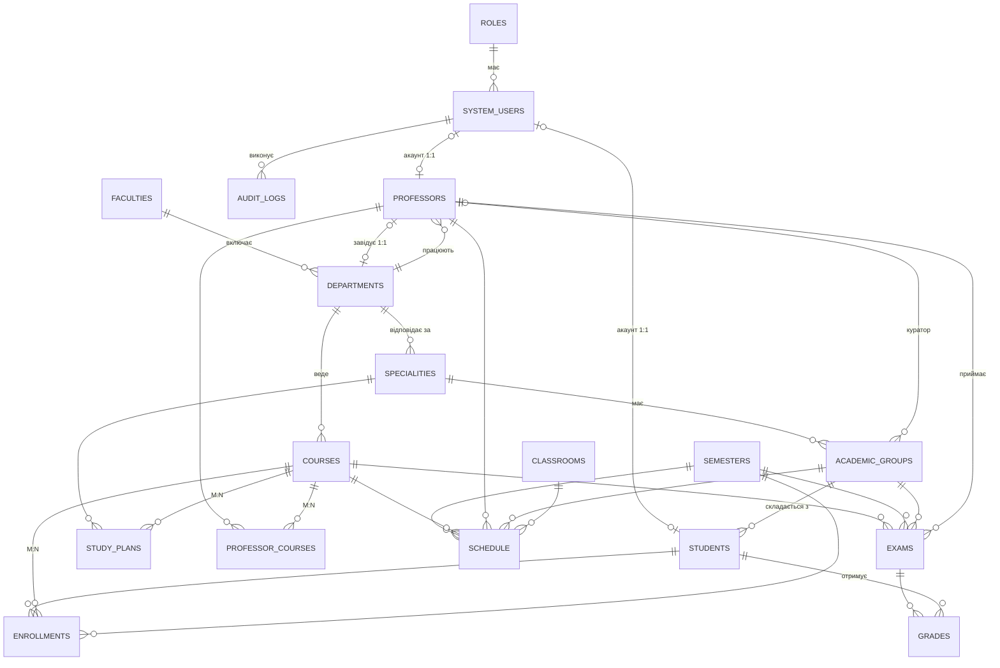

# Система управління університетом

**СУБД:** PostgreSQL 14+ (перевірено на 16) · **Код:** C# / .NET 8 + Npgsql + Dapper

| Файл | Зміст |
|---|---|
| `01_schema.sql` | 18 таблиць, PK/FK, CHECK, DEFAULT, UNIQUE |
| `02_objects.sql` | 4 функції, 6 тригерних функцій (+ підключення), 7 процедур, 4 представлення |
| `03_indexes.sql` | B-Tree, складені, partial unique, GIN (FTS + trigram), BRIN |
| `04_UniversityDal.cs` | Repository + Unit of Work (лише `CALL sp_*` / `SELECT … FROM v_*`) |

Запуск: `createdb university && psql -d university -f 01_schema.sql -f 02_objects.sql -f 03_indexes.sql`

---

## 1. Концептуальна і логічна схема

### ER-діаграма (Mermaid.js — вставити на mermaid.live)



### Зв'язки

| Тип | Зв'язок | Реалізація |
|---|---|---|
| **1-to-1** | SystemUsers ↔ Students, SystemUsers ↔ Professors | `user_id UNIQUE` + FK |
| **1-to-1** | Professors ↔ Departments (завідувач) | `departments.head_professor_id` UNIQUE + FK |
| **1-to-Many** | Faculties→Departments→Specialities→Groups→Students; Roles→SystemUsers; Departments→Professors/Courses; Classrooms→Schedule | FK на боці «багато» |
| **Many-to-Many** | Specialities ↔ Courses | `study_plans` |
| **Many-to-Many** | Professors ↔ Courses | `professor_courses` (складений PK) |
| **Many-to-Many** | Students ↔ Courses (по семестрах) | `enrollments`, `UNIQUE(student, course, semester)` |

### Типи даних (принципи)

* PK — `BIGINT GENERATED ALWAYS AS IDENTITY`; текст — `VARCHAR(n)`/`TEXT`; час — `TIMESTAMPTZ`; дати — `DATE`; бали — `NUMERIC(5,2)`; журнал аудиту — `JSONB`, `INET`.
* Довідники з фіксованим набором значень (статус, тип заняття, ступінь) — `VARCHAR + CHECK`, а не ENUM: простіше мігрувати.

## 2. Сутності (18)

Faculties, Departments, Specialities, Professors, Students, **AcademicGroups** (слово `groups` зарезервоване), Courses, StudyPlans, Classrooms, Schedule, Enrollments, Exams, Grades, SystemUsers, AuditLogs + додатково **Roles**, **Semesters**, **ProfessorCourses**.

## 3. Soft delete та контроль змін

* **Soft delete** (`is_deleted`, `deleted_at`): system_users, faculties, departments, specialities, professors, academic_groups, students, courses. Цілісність забезпечує `CHECK ((NOT is_deleted AND deleted_at IS NULL) OR (is_deleted AND deleted_at IS NOT NULL))`.
* **`updated_at` + `updated_by_user_id`**: усі вищі таблиці, а також schedule, enrollments, exams, grades.
* Як БД дізнається, хто змінює: процедури викликають `set_config('app.current_user_id', …, true)` (діє тільки в поточній транзакції), тригер `trg_touch_updated` читає значення.

## 5. Програмні об'єкти БД

| Тип | Об'єкти |
|---|---|
| **Тригери** | `trg_touch_updated` (updated_at/by), `trg_soft_delete_stamp` (deleted_at), `trg_soft_delete_instead` (**фізичний `DELETE` → `is_deleted = TRUE`**), `trg_professor_soft_delete_check` і `trg_group_soft_delete_check` (каскадні перевірки), `trg_audit_row` (журнал у `audit_logs` з JSONB «було/стало») |
| **Процедури** | `sp_add_student`, `sp_update_student_group`, `sp_soft_delete_professor`, `sp_soft_delete_student`, `sp_enroll_student`, `sp_set_grade`, `sp_add_schedule_entry` |
| **Функції** | `fn_student_avg_score` (середній бал, зважений за кредитами), `fn_is_classroom_busy`, `fn_course_free_seats`, `fn_score_to_letter` |
| **Views** | `v_students_full`, `v_group_schedule`, `v_student_performance`, `v_course_load` |

Бізнес-правила в `sp_enroll_student`: студент активний; курс існує; немає дубліката; `active < max_capacity`; сума кредитів семестру ≤ 30. Рядок курсу блокується `FOR UPDATE`, тому паралельні зарахування не переб'ють ліміт місць.

## 6. Індекси

| Тип | Приклад | Навіщо |
|---|---|---|
| **B-Tree** | `idx_students_group_id`, `idx_grades_student` | PostgreSQL **не** індексує FK автоматично; без них JOIN і перевірки в тригерах скануватимуть таблицю повністю |
| **Складений B-Tree** | `idx_schedule_room_slot (classroom, semester, day, start, end)` | Точно під запит `fn_is_classroom_busy` |
| **Partial (unique)** | `uq_students_email_active … WHERE NOT is_deleted` | Унікальність email лише серед живих записів: після soft delete адресу можна використати знову; індекс менший |
| **GIN — Full-Text** | `idx_courses_fts` | Пошук курсів за словами в назві/описі (`@@ plainto_tsquery`) |
| **GIN + pg_trgm** | `idx_students_lastname_trgm` | `ILIKE '%ков%'` — для B-Tree недоступний, для trigram GIN швидкий |
| **BRIN** | `idx_audit_performed_brin` | Журнал росте лише «вперед» за часом, BRIN займає кілька КБ і ефективний для діапазонів дат |

## 7. Repository + Unit of Work

* `IUnitOfWork` володіє одним з'єднанням і транзакцією; `Students`, `Courses`, `Enrollments` ділять їх, тому зарахування на кілька курсів + переведення групи — атомарні (`EnrollmentService`).
* **Жодних прямих `SELECT/INSERT/UPDATE` по таблицях**: запис — `CALL sp_*`, читання — `SELECT … FROM v_*`, обчислення — `SELECT fn_*`. Через `RepositoryBase` це єдині три шляхи до БД.
* INOUT-параметр процедури передається як `NULL::bigint`; `CALL` повертає його значення рядком результату (так отримуємо `student_id` / `enrollment_id`).
* Помилки бізнес-правил (`RAISE EXCEPTION`, SQLSTATE `P0001`) перетворюються на `BusinessRuleException`.
* Рекомендація: застосунок підключається ролью БД, якій дано лише `EXECUTE` на процедури/функції та `SELECT` на views, без прав на таблиці — тоді вимога «лише через SP і Views» гарантується на рівні СУБД.

## Додатково: DBML для dbdiagram.io (ядро схеми)

```dbml
Table faculties { faculty_id bigint [pk, increment] name varchar(200) [unique] short_name varchar(20) [unique] is_deleted boolean deleted_at timestamptz }
Table departments { department_id bigint [pk, increment] faculty_id bigint [ref: > faculties.faculty_id] head_professor_id bigint [unique, ref: - professors.professor_id] name varchar(200) }
Table specialities { speciality_id bigint [pk, increment] department_id bigint [ref: > departments.department_id] code varchar(10) [unique] name varchar(200) }
Table professors { professor_id bigint [pk, increment] department_id bigint [ref: > departments.department_id] user_id bigint [unique, ref: - system_users.user_id] email varchar(255) }
Table academic_groups { group_id bigint [pk, increment] speciality_id bigint [ref: > specialities.speciality_id] curator_id bigint [ref: > professors.professor_id] name varchar(30) [unique] }
Table students { student_id bigint [pk, increment] group_id bigint [ref: > academic_groups.group_id] user_id bigint [unique, ref: - system_users.user_id] student_card_no varchar(20) [unique] email varchar(255) }
Table courses { course_id bigint [pk, increment] department_id bigint [ref: > departments.department_id] code varchar(15) [unique] credits smallint max_capacity int }
Table semesters { semester_id bigint [pk, increment] academic_year varchar(9) term varchar(10) }
Table enrollments { enrollment_id bigint [pk, increment] student_id bigint [ref: > students.student_id] course_id bigint [ref: > courses.course_id] semester_id bigint [ref: > semesters.semester_id] status varchar(10) }
Table exams { exam_id bigint [pk, increment] course_id bigint [ref: > courses.course_id] semester_id bigint [ref: > semesters.semester_id] group_id bigint [ref: > academic_groups.group_id] professor_id bigint [ref: > professors.professor_id] }
Table grades { grade_id bigint [pk, increment] student_id bigint [ref: > students.student_id] exam_id bigint [ref: > exams.exam_id] score numeric(5,2) }
Table roles { role_id bigint [pk, increment] name varchar(50) [unique] }
Table system_users { user_id bigint [pk, increment] role_id bigint [ref: > roles.role_id] username varchar(60) email varchar(255) }
Table audit_logs { audit_id bigint [pk, increment] table_name varchar(63) record_id bigint action varchar(12) performed_by_user_id bigint [ref: > system_users.user_id] }
```
